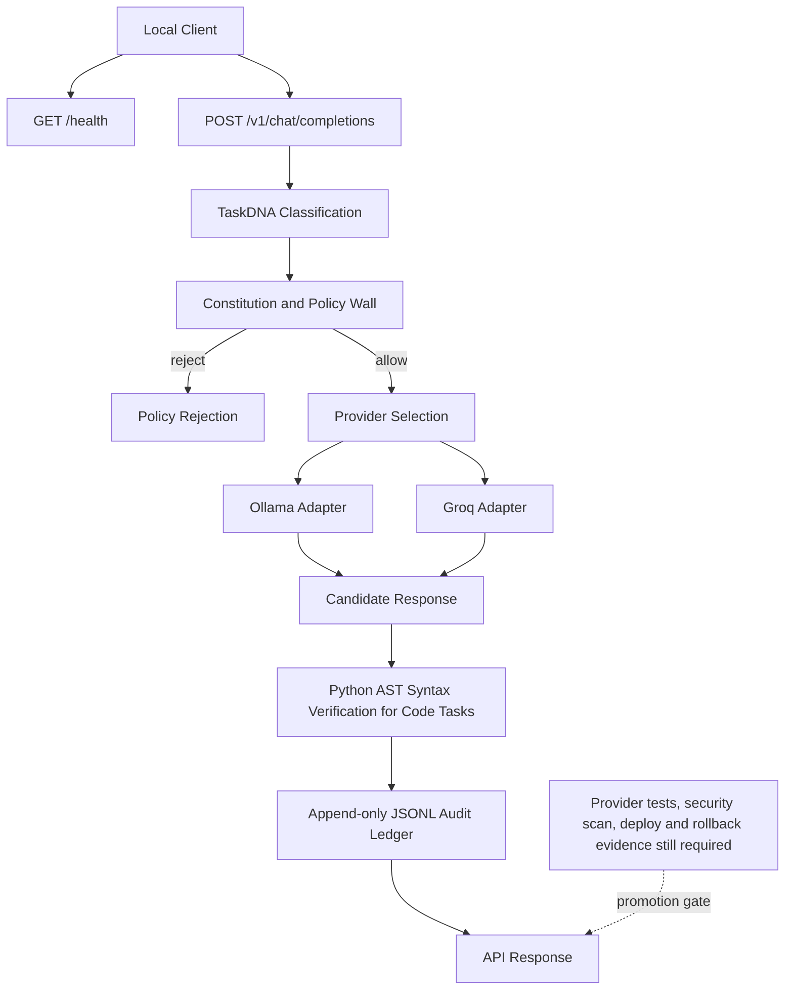
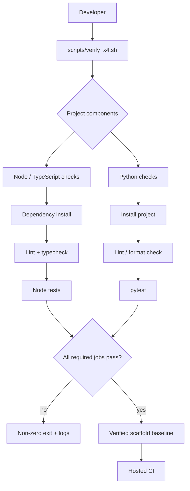

# Project Scaffold + X4-ARX369 Ω Beast Arsenal

This repository remains the Node.js/Express application scaffold and now contains a **dependency-light X4 runtime MVP** under `x4/`.

## X4 runtime

The current MVP provides:

- immutable-style Constitution and Policy Wall rejection
- task classification (`TaskDNA`)
- cost/quality/reliability-aware provider selection
- Ollama + Groq adapters
- AST-based Python syntax verification for code tasks
- append-only JSONL audit ledger
- HTTP `/health` and `/v1/chat/completions` endpoints

### Run locally

```bash
python -m x4.serve --host 127.0.0.1 --port 8080
```

Test a health check:

```bash
curl http://127.0.0.1:8080/health
```

Send a request:

```bash
curl -X POST http://127.0.0.1:8080/v1/chat/completions \
  -H "Content-Type: application/json" \
  -d '{"prompt":"Write a Python function that adds two numbers","task_type":"code_generation","estimated_budget":0.01}'
```

Ollama is selected only when healthy. Groq requires `GROQ_API_KEY`.

<!-- X4-APEX-DIAGRAM-START:project-scaffold -->



<!-- X4-APEX-DIAGRAM-END:project-scaffold -->

## Validation

X4 CI runs compile, Ruff lint, and pytest checks from `.github/workflows/x4-arsenal.yml`.

The MVP is an **implementation foundation**, not a claim of production validation. Production promotion still requires provider integration tests, security scanning, benchmark evidence, deployment verification, and rollback testing.

## Existing ARIEX service

The repository also retains the existing AriexCore model-fleet service under `src/arx/ai/`.

## Azure deployment

The existing Azure Developer CLI configuration remains available for the Node application:

```bash
azd up
```

MIT License.

## APEX Architecture Map

> Status: architecture documentation; implementation and deployment claims require independent verification.


**Evidence note:** The dual-stack flow is a target map. Verify the scripts and workflow job graph before claiming every step exists or passes.

